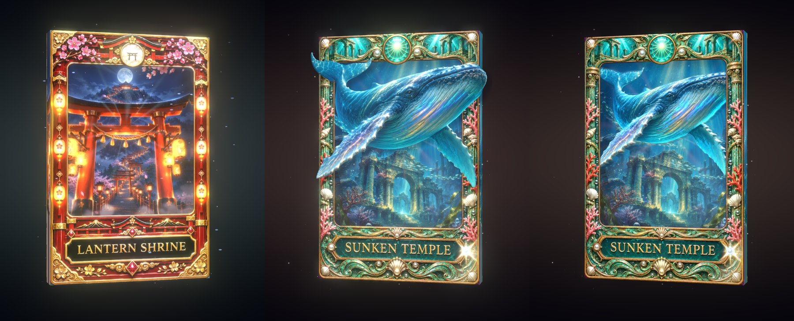

# Holo Card: a Claude Code skill



Turn any picture into a 3D holographic trading card that tilts with your mouse. It works with an anime character, a 3D render, a photo of a person, a pet, an object or a landscape.

The finished card:
- sits in a deep shadow box behind a foil frame;
- glows, with an aura around the character and a magic glyph behind it;
- has particles drifting through it and light rolling over the frame;
- pulls apart into its layers when you click.

It runs locally, in one web page, and it can also record itself to an MP4.

Two kinds of card:

| | Static 3D card | Animated card |
|---|---|---|
| Needs | Claude Code + this skill. Optional: any image generator for the frame art (local Qwen Image, ChatGPT, Grok, Gemini, Flux, SDXL) | the same, plus an image-to-video tool (Grok Imagine, Kling, Runway, Pika, Luma, local Wan or LTX-Video) |
| Background | the picture's own scene, gently alive (glitter, mist, light) | a real video loop of the scene |
| Frame | foil shimmer, glitter and a light sweep | plus the frame's own animated light |

## Install

```bash
git clone https://github.com/CodeCourtChannel/holo-card.git ~/.claude/skills/holo-card
bash ~/.claude/skills/holo-card/scripts/setup.sh            # Python tools (free local models download on first use)
bash ~/.claude/skills/holo-card/scripts/setup.sh --record   # optional: record videos + the quality check (Node 18+, ffmpeg)
```

## Use

In Claude Code:

```
/holo-card make a card from ~/Pictures/my-character.png
```

Claude asks four quick questions:
- static or animated;
- the name on the card;
- whether you can generate a frame image;
- whether you want to make the layers yourself in Qwen Image Edit.

Then it builds the card, checks it and opens it.

## How it works

1. **Layers.** From your picture, the skill makes:
   - a cut-out of the character (BiRefNet);
   - a clean background with the character removed (LaMa);
   - a depth map (Depth Anything V2).

   A layer you make yourself in Qwen Image Edit, or any editor, replaces its local version. The prompts are in `prompts/layers.md`.
2. **Frame.** You generate the frame art from the prompt in `prompts/frame.md`, with a flat magenta window. The skill cuts the window out. If you have no generator, the skill draws a built-in frame in the character's colours.
3. **Card.** The character becomes 28 soft-edged depth steps. It's centred and shallow, so it keeps its shape when the card tilts, and it stands in front of a deep background. The aura, glyph, rays and particles take the picture's own colours.
4. **Check.** `check.py` renders the card tilted left, straight on and tilted right, with the character alone underneath. Claude compares them: the character must stay the same figure when the card turns.
5. **Animate** (optional). Image-to-video of the background and of the frame. The skill turns them into seamless loops and keeps only the frame's moving light. The prompts are in `prompts/animate.md`.

## Files

| Path | What |
|---|---|
| `SKILL.md` | what Claude follows |
| `engine/card.html` | the card: three.js, a single page |
| `scripts/layers.py` | cut-out, clean background and depth from a picture |
| `scripts/card.py` | builds a card folder from the layers and frame |
| `scripts/check.py` | a left / front / right sheet to check the card |
| `scripts/bgvideo.py`, `scripts/frameanim.py` | animated card: background loop, frame light |
| `scripts/serve.py`, `scripts/record.cjs` | view the card locally, record it to MP4 |
| `prompts/` | frame, layer and animation prompts for any generator |

## Credits

- [three.js](https://threejs.org) (MIT)
- [BiRefNet](https://github.com/ZhengPeng7/BiRefNet) (MIT) and ISNet through [rembg](https://github.com/danielgatis/rembg) (MIT)
- [LaMa](https://github.com/advimman/lama) (Apache-2.0), using the [Carve/LaMa-ONNX](https://huggingface.co/Carve/LaMa-ONNX) export
- [Depth Anything V2 Small](https://github.com/DepthAnything/Depth-Anything-V2) (Apache-2.0), using the [onnx-community](https://huggingface.co/onnx-community/depth-anything-v2-small) export

The cards in the preview are original pictures (made with an image generator), animated with an image-to-video tool.

Cards of characters someone else owns (anime, games, films) are fan art: keep them personal.

## License

MIT
